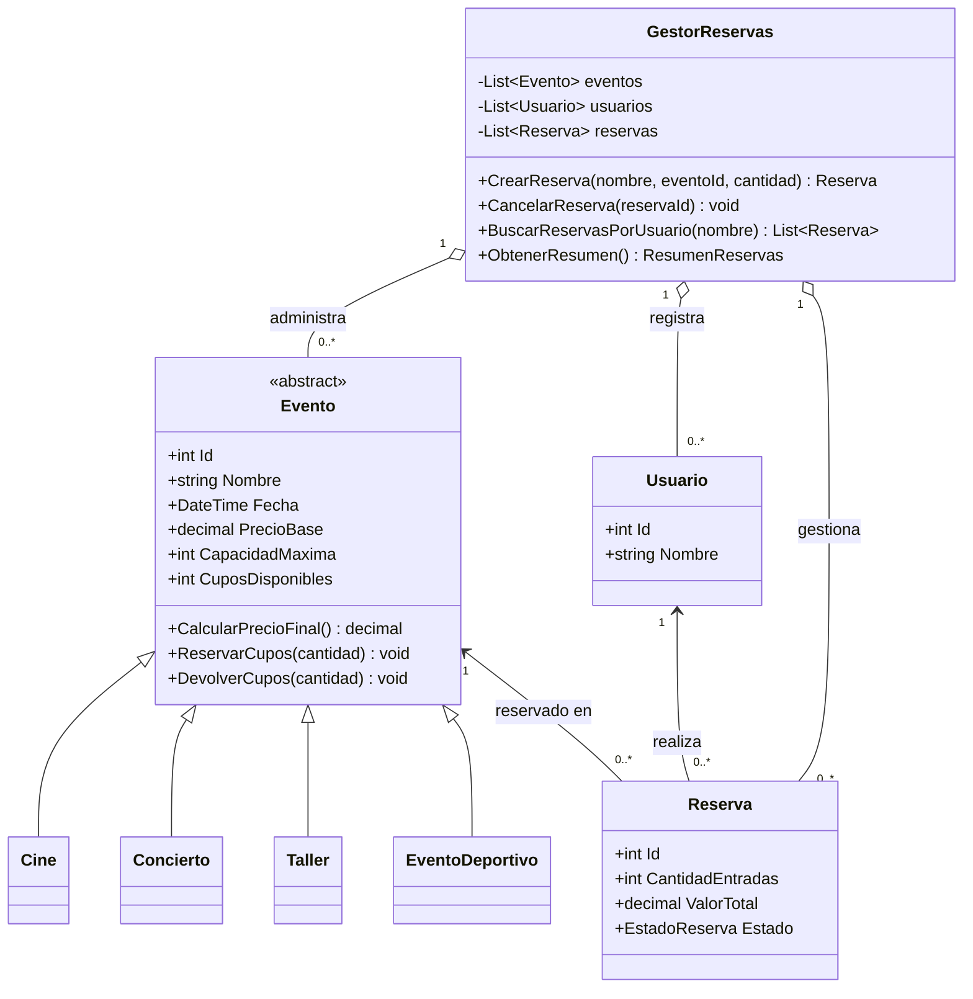

# PLANAZO - Eventos

Aplicación de consola en C# y .NET para consultar eventos, reservar entradas, cancelar reservas y revisar el resumen de ventas activas.

## Funcionalidades

- Catálogo inicial con dos películas, dos conciertos, dos talleres y un evento deportivo.
- Consulta de eventos, precios finales y cupos disponibles.
- Reservas asociadas a usuarios, con validación de cantidades y disponibilidad.
- Cancelación única de reservas, con devolución de cupos.
- Consulta de reservas por usuario y resumen de reservas activas.
- Manejo de errores de entrada sin cerrar inesperadamente el programa.

## Ejecución

Requiere .NET 10 SDK.

```bash
dotnet run
```

Para ejecutar los casos de verificación incluidos:

```bash
dotnet run -- --pruebas
```

## Clases y relaciones

- `Evento` es la clase abstracta con los atributos comunes y el control encapsulado de cupos.
- `Cine`, `Concierto`, `Taller` y `EventoDeportivo` heredan de `Evento` e implementan `CalcularPrecioFinal()`.
- `Usuario` representa a la persona que reserva; el gestor reutiliza el mismo usuario cuando coincide el nombre, sin distinguir mayúsculas.
- `Reserva` asocia un usuario con un evento, conserva la cantidad, el valor calculado al confirmar y el estado.
- `GestorReservas` administra las colecciones de eventos, usuarios y reservas, aplica las reglas de negocio y construye el resumen.
- `Program` presenta el menú y delega las operaciones al gestor.

Todos los valores monetarios se manejan con `decimal`.

## Conceptos de POO

- **Encapsulamiento:** las propiedades de los modelos son de solo lectura; los cupos y el estado de una reserva solo cambian mediante operaciones controladas. `Evento.ReservarCupos` impide cantidades inválidas o superiores a la disponibilidad.
- **Abstracción:** `Evento` establece los datos y el contrato `CalcularPrecioFinal()` comunes, sin representar un tipo concreto.
- **Herencia:** los cuatro tipos concretos extienden `Evento` y reutilizan sus datos y reglas de cupos.
- **Polimorfismo:** el catálogo contiene elementos `Evento`, pero cada instancia calcula su precio de forma distinta: cine mantiene el precio, concierto agrega 15 %, taller descuenta 10 % y evento deportivo agrega 8 %.
- **Asociación y composición:** una reserva referencia un usuario y un evento; el gestor contiene y administra las listas de objetos.
- **Colecciones y excepciones:** `GestorReservas` utiliza `List<T>` internamente y expone vistas de solo lectura; las reglas inválidas producen excepciones que el menú presenta sin terminar el proceso.

## Diagrama UML



## Sustentación

Utilicé una clase abstracta `Evento` porque Cine, Concierto, Taller y EventoDeportivo comparten identificador, nombre, fecha, precio base, capacidad y reglas de cupos. Así, `GestorReservas` puede almacenarlos juntos en `List<Evento>` y operar con todos mediante la misma interfaz.

La diferencia de precio se resuelve con el método polimórfico `CalcularPrecioFinal()`: `Cine` retorna `PrecioBase`, `Concierto` aplica `1.15m` y `Taller` aplica `0.90m`. Para agregar un tipo nuevo como `EventoDeportivo`, basta con heredar de `Evento` e implementar su regla (en este caso `1.08m`); el gestor y los tipos existentes no necesitan cambios para calcular el precio. Esto evita duplicar los datos y reglas comunes y facilita extender el catálogo.

## Estructura

```text
PLANAZO-POO-CSharp/
├── Modelos/
├── Servicios/
├── Pruebas/
├── Capturas/
├── Program.cs
├── README.md
└── .gitignore
```
